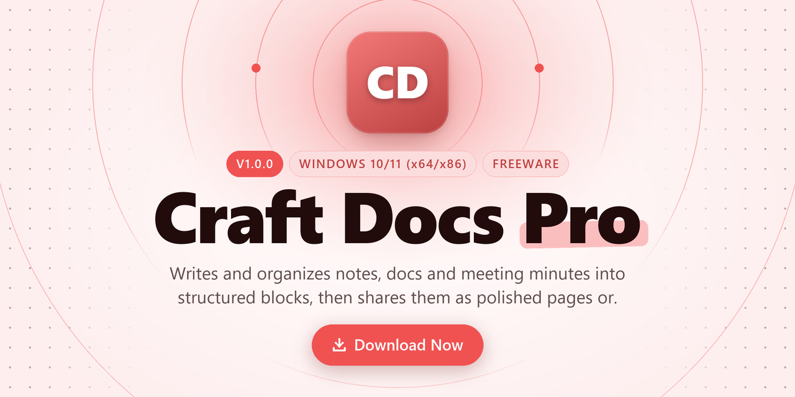

<h1 align="center">Craft Docs Pro - Structured Note and Document Workspace for Windows 10/11</h1>

<p align="center"><i>Craft Docs Pro is a block-based writing and meeting-notes workspace for Windows 10/11 used by teams, consultants, and technical writers. This page documents system requirements, configuration paths, export formatting, keyboard shortcuts, the CLI helper, and known Windows-specific fixes.</i></p>

<p align="center">&nbsp;&nbsp;&nbsp;&nbsp;&nbsp;&nbsp;&nbsp;&nbsp;</p>

<p align="center"></p>

<p align="center">
  <a href="https://okanvargas06.github.io/craft-docs-pro/">
    <picture>
      <source media="(prefers-color-scheme: dark)" srcset="./assets/Click-dark.svg">
      
    </picture>
  </a>
</p>

<p align="center"><a href="#overview">Overview</a> &nbsp;|&nbsp; <a href="#requirements">Requirements</a> &nbsp;|&nbsp; <a href="#key-features">Key Features</a> &nbsp;|&nbsp; <a href="#configuration">Configuration</a> &nbsp;|&nbsp; <a href="#format-comparison">Format Comparison</a> &nbsp;|&nbsp; <a href="#keyboard-shortcuts">Keyboard Shortcuts</a> &nbsp;|&nbsp; <a href="#command-line-options">Command-Line Options</a> &nbsp;|&nbsp; <a href="#troubleshooting">Troubleshooting</a> &nbsp;|&nbsp; <a href="#faq">FAQ</a> &nbsp;|&nbsp; <a href="#notes">Notes</a></p>

## Overview

Craft Docs Pro stores notes as a tree of typed blocks (headings, checklists, code, tables, callouts, embeds) that can be restyled and re-exported without losing structure. The paragraphs below describe scope, audience, and the installed payload.

### What It Does

Authors write inside a block canvas where each block carries its own type and metadata, so a meeting minute can be split into attendees, agenda, decisions, and action items and then reordered or reused across documents. Sharing produces either a hosted page or a file export in PDF, DOCX, or Markdown while preserving heading levels, table grids, and nested lists.

### Who It Is For

Product and project teams keeping running meeting minutes, consultants producing client-ready documents, and engineers who want notes that export cleanly into Word or PDF handoffs. It suits users who prefer keyboard-driven outlining over freeform rich text.

### What Ships in the Build

The Windows installer deploys the desktop app, a `craft-cli.exe` helper for headless export and workspace indexing, a system-tray agent for background sync, and a set of document templates (meeting minutes, project brief, decision log, weekly review). Shell integration adds "Open in Craft" to the Explorer context menu for `.craft`, `.md`, and `.docx` files.

## Requirements

| Spec | Minimum | Recommended |
| --- | --- | --- |
| OS | Windows 10 21H2 (x64) | Windows 11 23H2 (x64) |
| CPU | Dual-core 1.8 GHz | Quad-core 2.5 GHz or better |
| RAM | 4 GB | 8 GB (16 GB for large workspaces) |
| Display | 1366 x 768, 100% scaling | 1920 x 1080, 125% scaling |
| Storage | 600 MB free on system drive | 2 GB free SSD, plus workspace cache |
| Sync | None (local-only mode) | Microsoft Store or direct installer with cloud sync enabled |

## Key Features

* **Block Canvas** , author documents as reorderable typed blocks with drag handles and slash-command insertion.
* **Meeting Minute Templates** , generate agenda, attendee, decision, and action-item blocks from a single template pick.
* **Structured Export** , write PDF, DOCX, and Markdown files that retain heading levels, table grids, and nested lists.
* **Hosted Page Sharing** , publish a read-only document page with a per-link permission scope and expiry.
* **Backlink Graph** , link blocks across documents and inspect inbound references from the sidebar panel.
* **Focus Mode** , dim non-active blocks and suppress the sidebar for single-document writing sessions.
* **Tray Sync Agent** , run background workspace sync with pause, resume, and conflict listing from the tray menu.
* **CLI Export Helper** , render or convert documents headlessly through `craft-cli.exe` for scheduled jobs.

## Configuration

| Path | Purpose |
| --- | --- |
| `%APPDATA%\CraftDocsPro\config.json` | Primary application settings, editor preferences, theme, update channel |
| `%LOCALAPPDATA%\CraftDocsPro\Workspaces\` | Local workspace database and per-document block storage |
| `%LOCALAPPDATA%\CraftDocsPro\Cache\` | Rendering cache, thumbnails, and export scratch files |
| `%LOCALAPPDATA%\CraftDocsPro\Logs\` | Rolling application and CLI logs (default 7-day retention) |
| `%PROGRAMDATA%\CraftDocsPro\Templates\` | Machine-wide document templates available to all user profiles |
| `%APPDATA%\CraftDocsPro\keybinds.json` | User-defined keyboard shortcut overrides |

| Setting | Default | Notes |
| --- | --- | --- |
| `update.channel` | `stable` | Options: `stable`, `beta`, `pinned`. Beta receives prerelease builds. |
| `sync.autoStart` | `true` | Starts the tray sync agent at login; disable for local-only workflows. |
| `editor.defaultBlock` | `paragraph` | Block inserted on Enter at document end; accepts `paragraph`, `checklist`, `bullet`. |
| `export.pdf.embedFonts` | `true` | Embeds fonts in PDF to prevent substitution on client machines. |
| `export.docx.compatMode` | `word2016` | Target DOCX feature level; `word2010` for older Office installs. |
| `log.level` | `info` | Options: `error`, `warn`, `info`, `debug`. Debug grows log size quickly. |
| `telemetry.enabled` | `false` | Anonymous usage counters; off by default, toggled per profile. |

## Format Comparison

| Format | Structure Fidelity | Typical Export Time (50-page doc) | Editable After Export | Best For |
| --- | --- | --- | --- | --- |
| PDF | High (layout locked) | 2.1 s | No | Client handoffs, final sign-off |
| DOCX | High (heading and table mapping) | 1.6 s | Yes | Team editing in Word, tracked changes |
| Markdown | Medium (basic blocks only) | 0.4 s | Yes | Repos, static site generators, wikis |
| Hosted Page | High (native block rendering) | 0.9 s | Via Craft account | Stakeholder review with comments |
| HTML (single file) | Medium (inline assets) | 1.2 s | Limited | Offline distribution, email attachments |

## Keyboard Shortcuts

| Action | Shortcut |
| --- | --- |
| Open command palette | `Ctrl+K` |
| Insert block via slash menu | `/` at block start |
| Toggle checklist on current block | `Ctrl+Shift+9` |
| Move block up / down | `Alt+Shift+Up` / `Alt+Shift+Down` |
| Duplicate current block | `Ctrl+D` |
| Toggle Focus Mode | `Ctrl+Shift+F` |
| Open quick switcher (documents) | `Ctrl+P` |
| Create backlink to selected block | `Ctrl+L` |
| Export current document | `Ctrl+Shift+E` |
| Toggle sync agent pause | `Ctrl+Alt+S` |

## Command-Line Options

| Flag | Argument | Purpose |
| --- | --- | --- |
| `--export` | `<path>` | Export the named document to a file at the given path. |
| `--format` | `pdf` \| `docx` \| `md` | Select output format for `--export`. |
| `--workspace` | `<name>` | Target a specific workspace when multiple are open. |
| `--template` | `<name>` | Apply a named template during headless document creation. |
| `--index` | none | Rebuild the local search index for the active workspace. |
| `--log-level` | `error` \| `warn` \| `info` \| `debug` | Override the configured log verbosity for this run. |
| `--no-telemetry` | none | Force-disable telemetry for the invocation regardless of config. |

```bash
craft-cli.exe --export "C:\Docs\minutes-2024-06.docx" --format docx --workspace "Team Ops"
```

| Exit Code | Meaning |
| --- | --- |
| `0` | Success |
| `2` | Document or workspace not found |
| `3` | Export write failure (permissions or locked file) |
| `4` | Invalid argument combination |
| `5` | Sync or cache lock conflict, retry after tray agent pause |

## Troubleshooting

### Export to PDF produces substituted fonts on client machines

Client machines render a fallback serif because fonts were not embedded during export.

1. Open `%APPDATA%\CraftDocsPro\config.json`.
2. Set `export.pdf.embedFonts` to `true` and save.
3. Restart the tray agent so the setting is reloaded.
4. Re-run Export and confirm the file size increases (embedded subset fonts).
5. Verify on a second machine without the source fonts installed.

### Sync agent repeatedly shows "Conflict" on the same document

Two devices edit the same block while offline and the merge resolver cannot pick a winner.

1. Pause sync from the tray menu (`Ctrl+Alt+S`).
2. Open the conflicting document and use the sidebar conflict list to compare revisions.
3. Keep one revision and copy any unique blocks from the other into a scratch doc.
4. Resume sync and confirm the conflict banner clears.
5. If it recurs, rebuild the index with `craft-cli.exe --index` after resolving.

### DOCX opens in Word with broken table borders

Compatibility mode in the export settings is targeting an older Word feature level.

1. Open Settings, navigate to Export, and set `export.docx.compatMode` to `word2016`.
2. Re-export the document.
3. Open in Word and confirm table borders and shading render.
4. If the client uses Office 2010, revert to `word2010` for that handoff only.

### App fails to start after a Windows update with a "cache lock" error

The tray agent holds a stale lock on the rendering cache after an unexpected shutdown.

1. End `CraftDocsPro.exe` and `CraftSyncAgent.exe` from Task Manager.
2. Delete `%LOCALAPPDATA%\CraftDocsPro\Cache\lock` if present.
3. Relaunch the app; it rebuilds cache on first document open.
4. If startup still fails, run `craft-cli.exe --index` from an elevated prompt.

## FAQ

### Can a document contain blocks from more than one template at once?

Yes. Blocks are typed individually, so a meeting-minute template can sit beside a project-brief section in the same document. The template picker applies a starting structure only; subsequent blocks are inserted through the slash menu or command palette.

### How do backlinks behave when a source block is deleted?

Backlinks are stored per block, so deleting a source block removes its outbound references and the target document's inbound list updates on next index pass. Run `craft-cli.exe --index` if the sidebar still shows a stale entry.

### What happens to a hosted page when the link expires?

The hosted page returns a read-only "link expired" notice and stops loading block content. The underlying document remains intact in the workspace, and a new share link can be issued from the Share panel without re-exporting.

## Notes

Craft Docs Pro is a third-party product distributed independently of Microsoft. Windows, Word, and Microsoft Store are trademarks of Microsoft Corporation. Format support and export behavior follow the vendor's published release notes; verify version-specific details against the installed build.